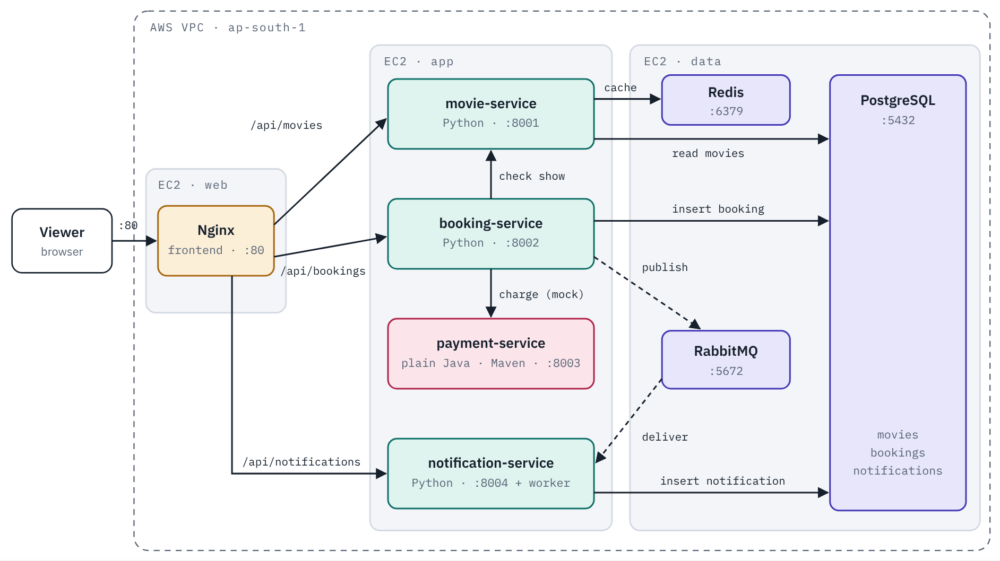
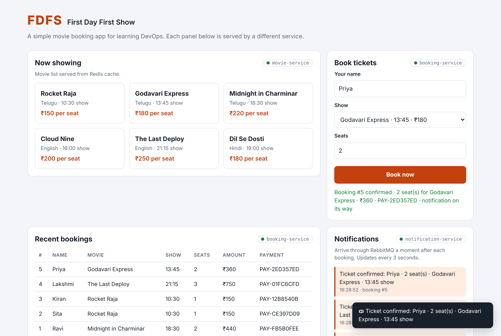

# FDFS — First Day First Show

A simple movie-booking app used to learn DevOps end to end, from deploying by hand to Kubernetes.
The app stays the same in every stage. Only the way we deploy it changes.

## Components

| Component | Server | Port | Technology | What it does |
|---|---|---|---|---|
| frontend | web | 80 | Nginx | Serves the website and routes `/api/...` to the services |
| movie-service | app | 8001 | Python (Flask, gunicorn) | Lists movies and shows, caches the list in Redis |
| booking-service | app | 8002 | Python (Flask, gunicorn) | Takes bookings, calls movie-service and payment-service, publishes to RabbitMQ |
| payment-service | app | 8003 | Java 21 (plain Java, built with Maven) | Mock payment, always approves. Internal only |
| notification-service | app | 8004 | Python (Flask, gunicorn) | Reads booking messages from RabbitMQ, saves and serves notifications |
| PostgreSQL | data | 5432 | PostgreSQL 16 | Tables: `movies`, `bookings`, `notifications` |
| Redis | data | 6379 | Redis 7 | Caches the movie list |
| RabbitMQ | data | 5672, 15672 | RabbitMQ 3.12 | Queue `booking.created`, web UI on 15672 |

## Servers

All three servers use **Ubuntu 24.04 LTS** and **t3.micro** (2 vCPU, 1 GB RAM), in the same VPC.
The app is kept small on purpose, so 1 GB is more than enough:

| Server | Runs | Memory used (measured) |
|---|---|---|
| fdfs-web | Nginx | ~20 MB |
| fdfs-app | 3 Python services (~70 MB each) + Java payment-service (~60 MB) | ~270 MB, plus ~230 MB for a few seconds while Maven builds |
| fdfs-data | PostgreSQL (~90 MB), RabbitMQ (~140 MB), Redis (~10 MB) | ~240 MB |

Use an **8 GB gp3** root disk (the default).

> Stop or terminate the servers when you finish practising. Running servers cost money.

## Security groups

🟡 SSH from your IP  🔴 Public internet  🔵 Only from another FDFS security group

### fdfs-web

| | Port | Source | Why |
|---|---|---|---|
| 🟡 | 22 | MY-IP/32 | SSH |
| 🔴 | 80 | 0.0.0.0/0 | Website |

### fdfs-app

| | Port | Source | Why |
|---|---|---|---|
| 🟡 | 22 | MY-IP/32 | SSH |
| 🔵 | 8001 | fdfs-web | Nginx → movie-service |
| 🔵 | 8002 | fdfs-web | Nginx → booking-service |
| 🔵 | 8004 | fdfs-web | Nginx → notification-service |

> Port 8003 (payment-service) is not opened. Only booking-service calls it, on the same server.

### fdfs-data

| | Port | Source | Why |
|---|---|---|---|
| 🟡 | 22 | MY-IP/32 | SSH |
| 🔵 | 5432 | fdfs-app | Services → PostgreSQL |
| 🔵 | 6379 | fdfs-app | movie-service → Redis |
| 🔵 | 5672 | fdfs-app | booking and notification → RabbitMQ |
| 🟡 | 15672 | MY-IP/32 | RabbitMQ web UI (for you only) |

## Install order

Dependencies first, then the services that use them, then the website.

1. [PostgreSQL](01-postgresql.md) — data server
2. [Redis](02-redis.md) — data server
3. [RabbitMQ](03-rabbitmq.md) — data server
4. [movie-service](04-movie-service.md) — app server
5. [payment-service](05-payment-service.md) — app server (Java + Maven)
6. [booking-service](06-booking-service.md) — app server
7. [notification-service](07-notification-service.md) — app server
8. [frontend](08-frontend.md) — web server
9. [Test the app](09-test-the-app.md) — smoke tests, failure demos and troubleshooting

## Values you will replace

| Placeholder | Replace with |
|---|---|
| `<DATA-SERVER-IP>` | Private IP of fdfs-data |
| `<APP-SERVER-IP>` | Private IP of fdfs-app |
| `<WEB-SERVER-PUBLIC-IP>` | Public IP of fdfs-web |
| `<DATA-SERVER-PUBLIC-IP>` | Public IP of fdfs-data (only to open the RabbitMQ UI) |

The code is downloaded from the public S3 bucket `fdfs-artifacts-30b67175` (version `v1` of every component), for example
`https://fdfs-artifacts-30b67175.s3.amazonaws.com/movie-service-v1.zip`.

Practice credentials used in these docs: database user `fdfs` / `FdfsPass123`, RabbitMQ user `fdfs` / `FdfsPass123`.
Use your own passwords for anything beyond practice.

## How every Python service is installed

The three Python services follow the same steps. Only the name, port and environment variables change.
This is the pattern we automate later with a shell function, an Ansible role and a Dockerfile.

1. Install Python
2. Create the `fdfs` app user
3. Create `/opt/fdfs/<service>`
4. Download and unzip the code
5. Create a virtualenv and install `requirements.txt`
6. Write `/etc/fdfs/<service>.env`
7. Create the systemd unit `fdfs-<service>.service`
8. Start it and check `/health`

The Java service is the exception: it has to be **built with Maven** first, and only the JAR is deployed.
It is plain Java with no framework, so the JAR is about 5 KB and it starts in under a second.
